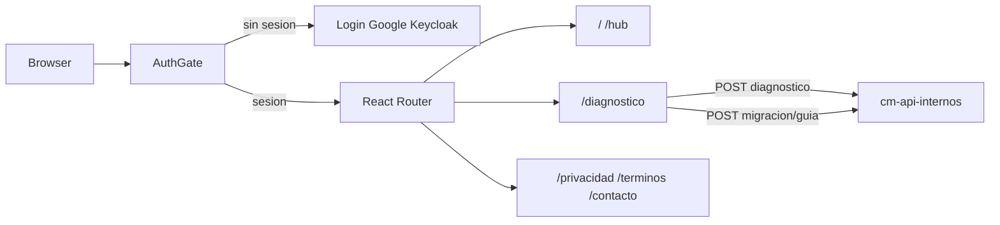

# Coordinadora Toolbox (`cm-toolbox-front`)

Portal interno de herramientas de apoyo para migración de guias y despachos (AGW → CM). El hub en `/` agrupa apps; la primera disponible es Diagnóstico de migración.

Stack: React 19, Vite, TypeScript, Tailwind CSS v4, Keycloak (`keycloak-js` 26.1.5), SIGO Droop Design System.

Versión: `1.6.0`.

## Arquitectura



## Rutas

| Ruta           | Pantalla                                                         |
| -------------- | ---------------------------------------------------------------- |
| `/`            | Hub de aplicaciones                                              |
| `/hub`         | Alias del hub (misma pantalla que `/`)                           |
| `/diagnostico` | Consulta de remisiones/despachos, re-migración, lista/cuadrícula |
| `/privacidad`  | Política de datos (Ley 1581)                                     |
| `/terminos`    | Términos de uso interno                                          |
| `/contacto`    | Datos institucionales y formulario                               |
| `/gracias`     | Confirmación del formulario de contacto                          |
| cualquier otra | 404                                                              |

El enrutado usa [React Router](https://reactrouter.com/) en modo declarativo (`BrowserRouter`, `Routes`, `Route`). Las páginas de herramienta y legales cargan con `lazy()` y `Suspense`.

## Inicio local

```bash
pnpm install
cp .env.example .env
pnpm dev
```

Vite sirve en `http://localhost:3000`. No subas `.env` a Git.

En `pnpm dev` no se pide Keycloak. Para probar el login local: `VITE_AUTH_FORCE_KEYCLOAK=true` en `.env`. El `pnpm build` de deploy siempre exige auth.

### Variables

| Variable                   | Uso                                                                     |
| -------------------------- | ----------------------------------------------------------------------- |
| `PORT`                     | Vite local (default `3000`). nginx/Cloud Run usa `8080`                 |
| `VITE_DIAGNOSTICO_URL`     | URL completa de `POST .../migracion/diagnostico`                        |
| `VITE_MIGRAR_GUIA_URL`     | Opcional. Si no está, se deriva reemplazando `/diagnostico` por `/guia` |
| `VITE_PUBSUB_SUBSCRIPTION` | Emulación Pub/Sub en re-migración (el API puede ignorarla)              |
| `VITE_KEYCLOAK_URL`        | Opcional. Issuer Keycloak; si falta se usa el default corporativo       |
| `VITE_KEYCLOAK_REALM`      | Opcional. Realm; solo junto con las otras dos                           |
| `VITE_KEYCLOAK_CLIENT_ID`  | Opcional. Client del SPA; solo junto con las otras dos                  |
| `VITE_KEYCLOAK_ENV`        | `dev` \| `test` \| `prod` (default `dev`)                               |
| `VITE_AUTH_FORCE_KEYCLOAK` | Solo local. `true` fuerza Keycloak en `pnpm dev`                        |

Las tres variables Keycloak opcionales solo aplican si se definen **las tres**; si no, `@itcoordinadora/cm-sigoo-temp-ui` resuelve el issuer según `VITE_KEYCLOAK_ENV`. Por eso no están en `env/azure.env`: un token `#{...}#` sin variable en la Library quedaría literal y construiría un cliente Keycloak inválido.

Ejemplo con prefijo URI del API:

```bash
VITE_DIAGNOSTICO_URL=http://localhost:8080/cm-api-internos/migracion/diagnostico
```

Timeout de diagnóstico: 120 s. Timeout de re-migración de una guía: 30 s.

## Auth

Keycloak con IdP Google (`idpHint: google`). Access token (`token_sigoo`) en `localStorage`; tokens de reanudación Keycloak en `sessionStorage`. Tema claro/oscuro y vista lista/cuadrícula en `localStorage`; sobreviven al logout.

Decisión de seguridad sobre tokens, CSP y riesgo XSS: [docs/seguridad-tokens-y-csp.md](docs/seguridad-tokens-y-csp.md).

Si no hay variables Keycloak, se usan los defaults de `@itcoordinadora/cm-sigoo-temp-ui` según `VITE_KEYCLOAK_ENV`.

## Docker

Vite genera `dist`; nginx (usuario no root) sirve el SPA y proxea `/migracion/` al API.

```bash
docker compose up --build
```

Abre `http://localhost:4173`. El contenedor escucha `PORT` (default `8080`, el mismo que Cloud Run). El API debe estar en el host en el puerto 8080.

`DIAGNOSTICO_API_UPSTREAM` es el host del API **incluyendo su prefijo URI y sin `/migracion`**; nginx le concatena el path de la petición. No hay ninguna URL de ambiente en el repo: el valor sale de la Azure DevOps Library.

Resolución del valor, de mayor a menor prioridad:

1. Variable de entorno del contenedor (Cloud Run o `docker-compose.yml`, que en local usa `http://host.docker.internal:8080/cm-api-internos`).
2. Default horneado en `/etc/nginx/runtime.env` durante el build y cargado por `nginx/04-load-runtime-env.envsh`.

El paso 2 existe porque el template corporativo despliega en Cloud Run **sin** variables de entorno. El pipeline copia `env/azure.env` a un `.env` en la raíz y resuelve ahí los tokens contra la Library (`env/azure.env` conserva los `#{...}#`), así que el `Dockerfile` extrae de ese `.env` únicamente `DIAGNOSTICO_API_UPSTREAM` y `KEYCLOAK_UPSTREAM`. Cada token de `env/azure.env` debe tener su variable en la Library del ambiente.

`.dockerignore` no excluye `.env`. Solo esas dos claves se extraen y solo `runtime.env` llega a la imagen final.

`nginx/05-validate-env.sh` aborta el arranque si la variable falta, no trae esquema `http(s)://`, termina en `/migracion` o apunta al propio contenedor (proxy recursivo → `502`).

`VITE_DIAGNOSTICO_URL` y las variables Keycloak se hornean en el build. Si cambian, reconstruye la imagen.

## Validación

```bash
pnpm test
pnpm coverage
pnpm lint
pnpm build
```

### Pruebas E2E (local)

Instala el navegador una vez:

```bash
pnpm exec playwright install chromium
```

Ejecuta la suite E2E (arranca Vite con bypass de Keycloak y mocks de API):

```bash
pnpm test:e2e
pnpm test:all
```

Contrato manual del API de diagnóstico: [docs/diagnostico-api-contrato.md](docs/diagnostico-api-contrato.md).

### Tamaño de bundle

```bash
pnpm analyze:bundle
```

Genera `reports/bundle-size.txt` (ignorado por Git). Línea base de referencia local: total JS ~869 kB raw / ~264 kB gzip; CSS ~48 kB raw / ~9 kB gzip (build Vite actual).

## Estructura

```text
src/
├── app/                    Composición, tema, rutas lazy
├── features/
│   ├── auth/               Login, error de auth, sin acceso
│   ├── hub/                Portal de apps
│   ├── diagnostico/        UI de la herramienta + api/
│   ├── legal/              Privacidad y términos
│   ├── contact/            Contacto
│   ├── feedback/           Página de gracias
│   └── not-found/          404
└── shared/
    ├── auth/               Keycloak, tokens, gate, bypass local
    ├── lib/                env, preferencias, analytics, títulos SEO
    └── ui/                 Header, footer, cookies
test/                       Vitest, espeja src/
env/azure.env               Tokens de Azure DevOps Library
nginx/                      Template + scripts de runtime
```

Tokens de marca: `src/index.css`. Reglas Cursor: `.cursor/rules/diseno-coordinadora-sigo.mdc` (SIGO) y `.cursor/rules/smoothui-complementos.mdc` (motion opcional MIT en `src/shared/ui/smoothui/`).

Guía de recorrido del diagnóstico: [docs/APRENDER_FRONT.md](docs/APRENDER_FRONT.md).
