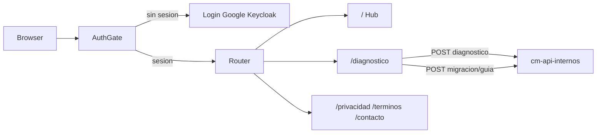

# Coordinadora Toolbox (`cm-toolbox-front`)

Portal interno de herramientas de apoyo para migración de guías y despachos (AGW → CM). El hub en `/` agrupa apps; la primera disponible es Diagnóstico de migración.

Stack: React 19, Vite, TypeScript, Tailwind CSS v4, Keycloak (`keycloak-js` 26.1.5), SIGO Droop Design System.

Versión: `1.1.0`.

## Arquitectura



## Rutas

| Ruta           | Pantalla                                                         |
| -------------- | ---------------------------------------------------------------- |
| `/`            | Hub de aplicaciones                                              |
| `/diagnostico` | Consulta de remisiones/despachos, re-migración, lista/cuadrícula |
| `/privacidad`  | Política de datos (Ley 1581)                                     |
| `/terminos`    | Términos de uso interno                                          |
| `/contacto`    | Datos institucionales y formulario                               |
| `/gracias`     | Confirmación del formulario de contacto                          |
| cualquier otra | 404                                                              |

El enrutado es nativo (`history` API), sin React Router.

## Inicio local

```bash
pnpm install
cp .env.example .env
pnpm dev
```

Vite sirve en `http://localhost:3000`. No subas `.env` a Git.

### Variables

| Variable                   | Uso                                                                     |
| -------------------------- | ----------------------------------------------------------------------- |
| `VITE_DIAGNOSTICO_URL`     | URL completa de `POST .../migracion/diagnostico`                        |
| `VITE_MIGRAR_GUIA_URL`     | Opcional. Si no está, se deriva reemplazando `/diagnostico` por `/guia` |
| `VITE_PUBSUB_SUBSCRIPTION` | Emulación Pub/Sub en re-migración (el API puede ignorarla)              |
| `VITE_KEYCLOAK_URL`        | Issuer Keycloak                                                         |
| `VITE_KEYCLOAK_REALM`      | Realm                                                                   |
| `VITE_KEYCLOAK_CLIENT_ID`  | Client del SPA                                                          |
| `VITE_KEYCLOAK_ENV`        | `dev` \| `test` \| `prod` (default `dev`)                               |

Ejemplo con prefijo URI del API:

```bash
VITE_DIAGNOSTICO_URL=http://localhost:8080/cm-api-internos/migracion/diagnostico
```

El timeout de diagnóstico es 120 s; el de re-migración de una guía es 30 s.

## Auth

Keycloak con IdP Google (`idpHint: google`). Los tokens van en `sessionStorage`. El tema y el modo lista/cuadrícula se guardan en `localStorage` y sobreviven al logout.

Si Keycloak no está configurado, usa los valores por defecto de `@itcoordinadora/cm-sigoo-temp-ui` según `VITE_KEYCLOAK_ENV`.

## Docker

El build genera `dist`; nginx (usuario no root) sirve el SPA y hace proxy a `/migracion/` hacia el API.

```bash
docker compose up --build
```

Abre `http://localhost:4173`. El API debe estar en el host en el puerto 8080.

`DIAGNOSTICO_API_UPSTREAM` default: `http://host.docker.internal:8080/cm-api-internos` (nginx concatena `/migracion/`).

`VITE_DIAGNOSTICO_URL` y las variables Keycloak se hornean en el build. Si cambian, reconstruye la imagen.

## Validación

```bash
pnpm test
pnpm lint
pnpm build
```

## Estructura

```text
src/
├── app/                    Composición, tema claro/oscuro
├── features/
│   ├── auth/               Login, error de auth, sin acceso
│   ├── hub/                Portal de apps
│   ├── diagnostico/        Formulario, resultados, modal de guía
│   ├── legal/              Privacidad y términos
│   ├── contact/            Contacto
│   ├── feedback/           Página de gracias
│   └── not-found/          404
└── shared/
    ├── auth/               Keycloak, tokens, gate
    ├── api/                Cliente de diagnóstico y re-migración
    ├── router/             Router nativo
    ├── lib/                env, preferencias, analytics, títulos SEO
    └── ui/                 Header, footer, cookies, Rare UI (motion)
```

Tokens de marca: `src/index.css`. Regla Cursor: `.cursor/rules/diseno-coordinadora-sigo.mdc`.

Guía de recorrido del diagnóstico: [docs/APRENDER_FRONT.md](docs/APRENDER_FRONT.md).
