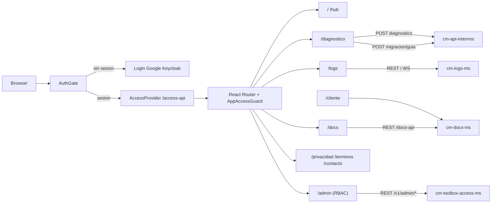

# Coordinadora Toolbox (`cm-toolbox-front`)

Portal interno de herramientas de apoyo para migración de guias y despachos (AGW → CM). El hub en `/` agrupa apps; la primera disponible es Diagnóstico de migración.

Stack: React 19, Vite, TypeScript, Tailwind CSS v4, Keycloak (`keycloak-js` 26.2.4), SIGO Droop Design System.

Versión: `1.9.0`.

## Arquitectura



## Rutas

| Ruta           | Pantalla                                                            |
| -------------- | ------------------------------------------------------------------- |
| `/`            | Hub de aplicaciones (catálogo dinámico según rol y estado)          |
| `/hub`         | Alias del hub (misma pantalla que `/`)                              |
| `/diagnostico` | Consulta de remisiones/despachos, re-migración, lista/cuadrícula    |
| `/logs`        | Visor de logs GKE en tiempo real (Test y Producción)                |
| `/docs`        | Catálogo y visor OpenAPI (internos)                                 |
| `/cliente/*`   | Puerta clientes (login + docs, sin hub)                             |
| `/admin`       | Administración de usuarios, roles, herramientas del Hub y auditoría |
| `/privacidad`  | Política de datos (Ley 1581)                                        |
| `/terminos`    | Términos de uso interno                                             |
| `/contacto`    | Datos institucionales y formulario                                  |
| `/gracias`     | Confirmación del formulario de contacto                             |
| cualquier otra | 404                                                                 |

El enrutado usa [React Router](https://reactrouter.com/) en modo declarativo (`BrowserRouter`, `Routes`, `Route`). Las páginas de herramienta y legales cargan con `lazy()` y `Suspense`.

## Inicio local

```bash
pnpm install
cp .env.example .env
pnpm dev
```

`pnpm dev` levanta Vite y los MS hermanos (`cm-toolbox-access-ms`, `cm-docs-ms`, `cm-logs-ms`) en `../` — no incluye `cm-api-internos`. También intenta `docker compose up -d` en access (Postgres/Redis). Solo front: `pnpm dev:front`. Si los repos no están al lado: `TOOLBOX_LOCAL_ROOT=/ruta/a/local pnpm dev`.

Vite sirve en `http://localhost:3000`. No subas `.env` a Git.

En `pnpm dev` no se pide Keycloak. Para probar el login local: `VITE_AUTH_FORCE_KEYCLOAK=true` en `.env`. El `pnpm build` de deploy siempre exige auth.

### Variables

| Variable                           | Uso                                                                                                                          |
| ---------------------------------- | ---------------------------------------------------------------------------------------------------------------------------- |
| `PORT`                             | Vite local (default `3000`). nginx/Cloud Run usa `8080`                                                                      |
| `DIAGNOSTICO_API_UPSTREAM`         | Host del API de migración, solo en el servidor (Vite/nginx). El navegador llama `/migracion/diagnostico` y `/migracion/guia` |
| `LOGS_API_UPSTREAM`                | Host de `cm-logs-ms` (default `http://localhost:8081`). El navegador llama `/logs-api/*`                                     |
| `ACCESS_API_UPSTREAM`              | Host de `cm-toolbox-access-ms` (default `http://localhost:8083`). El navegador llama `/access-api/*`                         |
| `DOCS_API_UPSTREAM`                | Host de `cm-docs-ms` (default `http://localhost:8082`). El navegador llama `/docs-api/*`                                     |
| `VITE_KEYCLOAK_CLIENT_ID_CLIENTES` | Client OIDC para `/cliente` (sin Google). Ver `docs/docs-feature/auth-clientes.md`                                           |
| `VITE_PUBSUB_SUBSCRIPTION`         | Emulación Pub/Sub en re-migración (el API puede ignorarla)                                                                   |
| `VITE_KEYCLOAK_URL`                | Opcional. Issuer Keycloak; si falta se usa el default corporativo                                                            |
| `VITE_KEYCLOAK_REALM`              | Opcional. Realm; solo junto con las otras dos                                                                                |
| `VITE_KEYCLOAK_CLIENT_ID`          | Opcional. Client del SPA; solo junto con las otras dos                                                                       |
| `VITE_KEYCLOAK_ENV`                | `dev` \| `test` \| `prod` (default `dev`)                                                                                    |
| `VITE_AUTH_FORCE_KEYCLOAK`         | Solo local. `true` fuerza Keycloak en `pnpm dev`                                                                             |

Las tres variables Keycloak opcionales solo aplican si se definen **las tres**; si no, `@itcoordinadora/cm-sigoo-temp-ui` resuelve el issuer según `VITE_KEYCLOAK_ENV`. Por eso no están en `env/azure.env`: un token `#{...}#` sin variable en la Library quedaría literal y construiría un cliente Keycloak inválido.

Ejemplo para `pnpm dev`, en `.env` (no entra al bundle):

```bash
DIAGNOSTICO_API_UPSTREAM=http://localhost:8080/cm-api-internos
```

Timeout de diagnóstico: 120 s. Timeout de re-migración de una guía: 30 s.

## Auth

Keycloak con IdP Google (`idpHint: google`). Access token (`token_sigoo`) en `localStorage`; tokens de reanudación Keycloak en `sessionStorage`. Tema claro/oscuro y vista lista/cuadrícula en `localStorage`; sobreviven al logout.

Decisión de seguridad sobre tokens, CSP y riesgo XSS: [docs/seguridad-tokens-y-csp.md](docs/seguridad-tokens-y-csp.md).

Documentación de APIs (feature completa): [docs/docs-feature/guia-operativa.md](docs/docs-feature/guia-operativa.md) — qué correr, variables, IAM y checklist.

Local con Keycloak test + MS locales: [docs/local-como-test.md](docs/local-como-test.md).

`pnpm dev` levanta infra (`docker-compose.dev.yml`: Postgres + Redis), access/docs/logs y Vite. Solo UI: `pnpm dev:front`.

Si no hay variables Keycloak, se usan los defaults de `@itcoordinadora/cm-sigoo-temp-ui` según `VITE_KEYCLOAK_ENV`.

## Docker

Vite genera `dist`; nginx (usuario no root) sirve el SPA y proxea `/migracion/` al API.

```bash
docker compose up --build
```

Abre `http://localhost:4173`. El contenedor escucha `PORT` (default `8080`, el mismo que Cloud Run). El API debe estar en el host en el puerto 8080.

`DIAGNOSTICO_API_UPSTREAM` es el host del API **incluyendo su prefijo URI y sin `/migracion`**; nginx le concatena el path de la petición. No hay ninguna URL de ambiente en el repo: el valor sale de la Azure DevOps Library.

`LOGS_API_UPSTREAM` (opcional) es `esquema://host[:puerto]` de cm-logs-ms, **sin path**. El navegador solo ve `/logs-api/` (REST y WebSocket same-origin) y nginx lo proxea quitando el prefijo; sin valor, `/logs-api/` responde 503. En cm-logs-ms, `CORS_ORIGINS` debe incluir el origen público del toolbox y `TRUST_PROXY=1`. En `pnpm dev`, Vite aplica el mismo proxy hacia `LOGS_API_UPSTREAM` (default `http://localhost:8081`).

Resolución del valor, de mayor a menor prioridad:

1. Variable de entorno del contenedor (Cloud Run o `docker-compose.yml`, que en local usa `http://host.docker.internal:8080/cm-api-internos`).
2. Default horneado en `/etc/nginx/runtime.env` durante el build y cargado por `nginx/04-load-runtime-env.envsh`.

El paso 2 existe porque el template corporativo despliega en Cloud Run **sin** variables de entorno. El pipeline copia `env/azure.env` a un `.env` en la raíz y resuelve ahí los tokens contra la Library (`env/azure.env` conserva los `#{...}#`), así que el `Dockerfile` extrae de ese `.env` únicamente `DIAGNOSTICO_API_UPSTREAM`, `KEYCLOAK_UPSTREAM` y `LOGS_API_UPSTREAM`. Cada token de `env/azure.env` debe tener su variable en la Library del ambiente.

`.dockerignore` no excluye `.env`. Solo esas dos claves se extraen y solo `runtime.env` llega a la imagen final.

`nginx/05-validate-env.sh` aborta el arranque si la variable falta, no trae esquema `http(s)://`, termina en `/migracion` o apunta al propio contenedor (proxy recursivo → `502`).

Las variables Keycloak se hornean en el build porque el navegador redirige al IdP. `DIAGNOSTICO_API_UPSTREAM` y `LOGS_API_UPSTREAM` no: el JavaScript solo ve rutas del mismo origen.

## Validación

```bash
pnpm test
pnpm coverage
pnpm lint
pnpm build
```

### Pruebas E2E (local)

Instala el navegador una vez:

```bash
pnpm exec playwright install chromium
```

Ejecuta la suite E2E (arranca Vite con bypass de Keycloak y mocks de API):

```bash
pnpm test:e2e
pnpm test:all
```

Contrato manual del API de diagnóstico: [docs/diagnostico-api-contrato.md](docs/diagnostico-api-contrato.md).

### Tamaño de bundle

```bash
pnpm analyze:bundle
```

Genera `reports/bundle-size.txt` (ignorado por Git). Línea base de referencia local: total JS ~869 kB raw / ~264 kB gzip; CSS ~48 kB raw / ~9 kB gzip (build Vite actual).

## Estructura

```text
src/
├── app/                    Composición, tema, rutas lazy
├── features/
│   ├── admin/              Panel RBAC: usuarios, roles, registro/estado de apps y auditoría
│   ├── auth/               Login, error de auth, sin acceso
│   ├── hub/                Portal dinámico de apps
│   ├── diagnostico/        UI de la herramienta + api/
│   ├── logs/               Visor de logs GKE en tiempo real
│   ├── legal/              Privacidad y términos
│   ├── contact/            Contacto
│   ├── feedback/           Página de gracias
│   └── not-found/          404
├── shared/
│   ├── auth/               Keycloak, tokens, gate, AccessProvider, AppAccessGuard y bypass local
│   ├── lib/                env, preferencias, analytics, títulos SEO
│   └── ui/                 Header, footer, cookies
sql/                        Esquema PostgreSQL (001_schema, 002_seed, 003_views_and_queries)
docs/rbac-feature/          Especificación técnica detallada del sistema RBAC y gestión de apps
test/                       Vitest, espeja src/
env/azure.env               Tokens de Azure DevOps Library
nginx/                      Template + scripts de runtime
```

Tokens de marca: `src/index.css`. Reglas Cursor: `.cursor/rules/diseno-coordinadora-sigo.mdc` (SIGO) y `.cursor/rules/smoothui-complementos.mdc` (motion opcional MIT en `src/shared/ui/smoothui/`).

Guía de recorrido del diagnóstico: [docs/APRENDER_FRONT.md](docs/APRENDER_FRONT.md).
