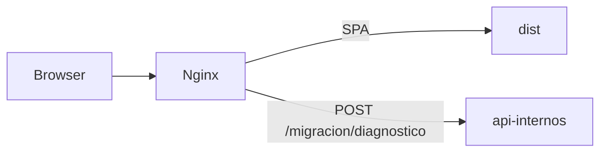

# Diagnóstico de migración

Front interno de solo lectura para consultar remisiones y despachos migrados de AGW a CM.

La interfaz usa un fondo ambiental animado en CSS puro y superficies translúcidas. La intensidad se ajusta con `--amb-alpha` en `src/index.css`; el detalle está en la [guía](docs/APRENDER_FRONT.md).

## Inicio

```bash
pnpm install
cp .env.example .env
pnpm dev
```

Configura en `.env` la URL completa del endpoint, incluyendo el prefijo `URI` del API:

```bash
VITE_DIAGNOSTICO_URL=http://localhost:8080/cm-api-internos/migracion/diagnostico
```

No subas `.env` a Git.

## Docker

El front es estático: Vite genera `dist` y nginx lo sirve. Compose sirve para local (puerto + proxy al API). En un cluster basta el `Dockerfile`.



```bash
docker compose up --build
```

Abre `http://localhost:4173`. El API debe escuchar en el host en el puerto 8080. El default de `DIAGNOSTICO_API_UPSTREAM` es `http://host.docker.internal:8080/cm-api-internos`; nginx concatena `/migracion/`.

`VITE_DIAGNOSTICO_URL` se hornea en el build (`/migracion/diagnostico` en Docker). Si la cambias, reconstruye la imagen.

## Validación

```bash
pnpm test
pnpm lint
pnpm build
```

La guía [Aprender front con este proyecto](docs/APRENDER_FRONT.md) explica la estructura, React, Tailwind y el recorrido de una consulta.
