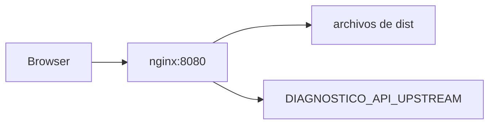
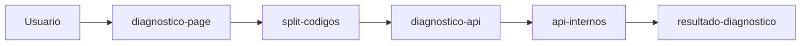
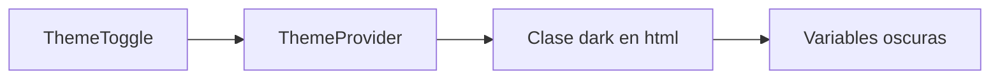
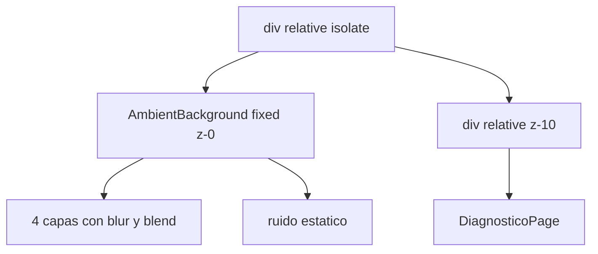
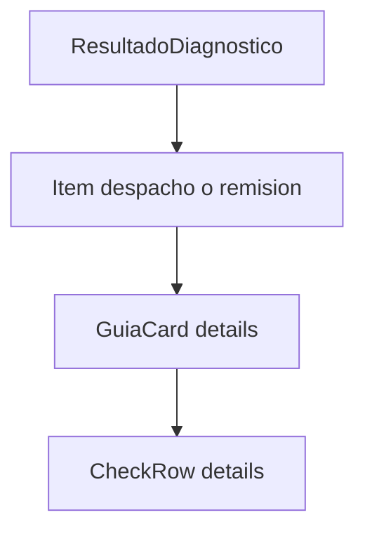
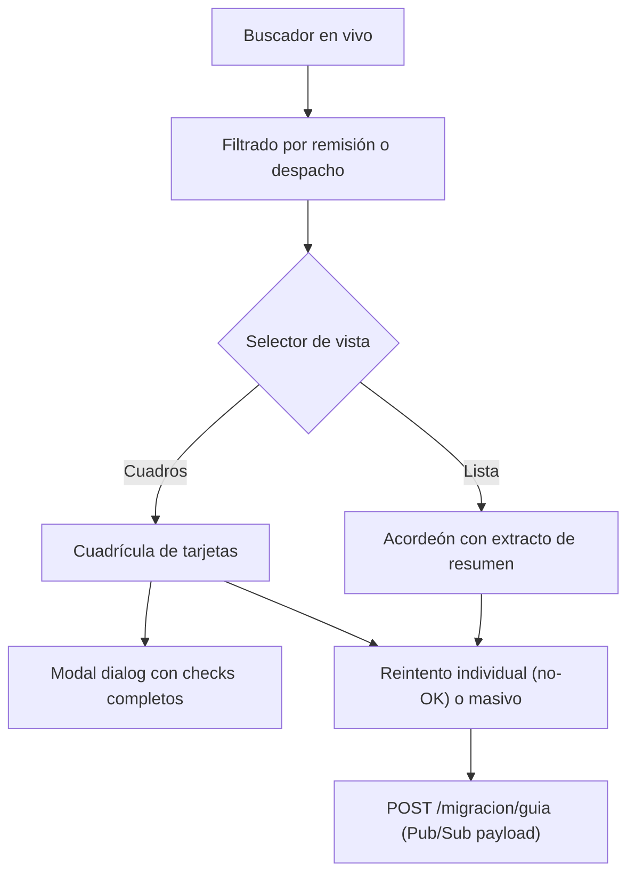

# Aprender front con este proyecto

Esta guía recorre el código real de la pantalla de diagnóstico. No necesitas experiencia previa con React.

## 1. Mapa del proyecto

```text
src/
├── app/
│   ├── app.tsx                 Une la aplicación, ErrorBoundary y el fondo
│   └── theme-provider.tsx      Guarda y aplica claro/oscuro (safeStorage)
├── features/diagnostico/
│   ├── diagnostico-page.tsx    Layout split de 2 columnas, formulario, cancelación y estado
│   ├── diagnostico-skeleton.tsx Esqueleto de carga con animación de pulsación
│   ├── resultado-diagnostico.tsx Buscador, filtros, acordeón, selector y copia de fallidas
│   ├── guia-gallery-card.tsx   Tarjeta para vista en cuadrícula amplia (hasta 3-4 cols)
│   ├── guia-detalle-modal.tsx  Modal dialog con scroll-lock, trampa de foco y checks
│   └── check-row.tsx           Fila desplegable de cada check
├── shared/
│   ├── api/                    Tipos y llamadas HTTP (diagnóstico y reintento con AbortSignal)
│   ├── lib/                    Parseo de códigos, safeStorage y validación de env
│   └── ui/                     Piezas visuales reutilizables (ErrorBoundary, CopyButton, etc.)
├── index.css                   Colores y estilos globales
└── main.tsx                    Enciende React
```

## 2. Ejecutarlo

```bash
pnpm install
cp .env.example .env
pnpm dev
```

Abre la URL que imprime Vite (normalmente `http://localhost:5173`).

En `.env`, configura la URL completa:

```bash
VITE_DIAGNOSTICO_URL=http://localhost:8080/migracion/diagnostico
```

No subas `.env` a Git. `.env.example` documenta el nombre de la variable sin guardar datos de ambiente.

## 2.1 Docker

`pnpm dev` es el día a día. Docker es para correr la misma app como la serviría un contenedor: HTML estático + nginx.



| Pieza                         | Rol                                              |
| ----------------------------- | ------------------------------------------------ |
| `Dockerfile` etapa `build`    | `pnpm build` con `VITE_DIAGNOSTICO_URL`          |
| `Dockerfile` etapa final      | nginx-unprivileged, usuario no root, puerto 8080 |
| `nginx/default.conf.template` | SPA fallback + proxy `/migracion/` + `/healthz`  |
| `docker-compose.yml`          | Mapea `4173:8080` y el upstream del API          |
| `.dockerignore`               | Excluye secretos y basura del contexto           |

Compose sí hace falta en local: ahí se define a qué API proxea nginx. En un cluster usas solo el `Dockerfile` y pasas `DIAGNOSTICO_API_UPSTREAM` como variable de runtime.

```bash
docker compose up --build
```

| Variable                   | Cuándo          | Ejemplo                            |
| -------------------------- | --------------- | ---------------------------------- |
| `VITE_DIAGNOSTICO_URL`     | Build (ARG)     | `/migracion/diagnostico`           |
| `DIAGNOSTICO_API_UPSTREAM` | Runtime (nginx) | `http://host.docker.internal:8080` |

`host.docker.internal` apunta a tu máquina. En Linux el compose ya agrega `host-gateway`. Si el API corre en otra red Docker, usa el nombre del servicio (`http://api-internos:8080`).

## 3. El viaje de un clic



1. React guarda el texto de las dos cajas.
2. `splitCodigos` separa remisiones; `parseDespachos` valida números.
3. `diagnosticarMigracion` hace el `POST` y cancela después de 120 segundos.
4. React guarda la respuesta en `data`.
5. `ResultadoDiagnostico` transforma `data.items` en acordeones (una fila por guía).

## 4. React en el código real

Un componente es una función que retorna interfaz:

```tsx
const Titulo = ({ texto }: { texto: string }) => <h1>{texto}</h1>;
```

Conceptos usados:

| Concepto     | Ejemplo en este repo                 | Para qué sirve                      |
| ------------ | ------------------------------------ | ----------------------------------- |
| Componente   | `ThemeToggle`                        | Pieza reutilizable de UI            |
| Prop         | `veredicto` en `VeredictoBadge`      | Dato que entra al componente        |
| Estado       | `useState` en `DiagnosticoPage`      | Dato que cambia en pantalla         |
| Efecto       | `useEffect` en `ThemeProvider`       | Sincroniza el tema con el HTML      |
| Evento       | `handleSubmit`                       | Reacciona al formulario             |
| `<details>`  | `GuiaCard` y `CheckRow`              | Acordeón nativo, sin librería extra |
| `Set` de ids | `abiertas` en `ResultadoDiagnostico` | Qué guías están abiertas            |

## 5. Cómo leer Tailwind

Tailwind compone estilos con clases pequeñas:

```tsx
className = "rounded-3xl border bg-[var(--surface)] p-5";
```

| Clase                 | Resultado                           |
| --------------------- | ----------------------------------- |
| `rounded-3xl`         | Esquinas muy redondeadas            |
| `border`              | Borde de un píxel                   |
| `bg-[var(--surface)]` | Fondo del token `--surface`         |
| `p-5`                 | Espacio interior                    |
| `sm:grid-cols-2`      | Dos columnas desde pantalla pequeña |

Los colores no se repiten en cada componente: viven como variables en `src/index.css`.

## 6. Tema claro y oscuro



Al iniciar:

1. Busca `theme` en `localStorage`.
2. Si no existe, consulta `prefers-color-scheme`.
3. Agrega o quita la clase `dark` en `<html>`.
4. CSS cambia los tokens (`--bg`, `--surface`, `--text`, etc.).

No uses negro puro (`#000`) ni blancos saturados en oscuro: el contraste se siente brusco. Los tokens viven en el bloque `.dark` de `src/index.css`.

| Token                              | Claro     | Oscuro       | Rol                                     |
| ---------------------------------- | --------- | ------------ | --------------------------------------- |
| `--bg`                             | `#f5f5f7` | `#15161a`    | Fondo de página (carbón, no negro)      |
| `--surface`                        | `#ffffff` | `#1d1f24`    | Cards y formulario                      |
| `--text`                           | `#1d1d1f` | `#e7e8ec`    | Texto principal (gris claro, no blanco) |
| `--muted`                          | `#6e6e73` | `#9b9da5`    | Subtítulos                              |
| `--line`                           | `#d2d2d7` | `#2e3138`    | Bordes                                  |
| `--accent`                         | `#0071e3` | `#58a6ff`    | Botones y enlaces                       |
| `--accent-fg`                      | `#ffffff` | `#11151c`    | Texto sobre el acento                   |
| `--shadow-card` / `--shadow-panel` | suave     | más profunda | Sombra de cards (en oscuro sí se ve)    |

Los badges de veredicto y “Cumple / No cumple” usan `color-mix` sobre `--ok`, `--parcial`, `--bloqueada`, etc. Si cambias el token, el badge sigue el tema.

## 7. Fondo ambiental

`AmbientBackground` (`src/shared/ui/ambient-background.tsx`) dibuja una iluminación difusa que se mueve muy despacio detrás de todo. Es decorativa: `aria-hidden`, `pointer-events: none` y `position: fixed`, así que no toca el layout ni el scroll.



Son cinco nodos DOM y CSS puro. Sin librerías, sin canvas, sin WebGL.

### Por qué no se ven bolas moviéndose

| Técnica                                              | Efecto                                       |
| ---------------------------------------------------- | -------------------------------------------- |
| Cada capa mide `120vmax`                             | Nunca cabe en pantalla, no se ve su contorno |
| Dos elipses desfasadas por capa                      | No se lee como una esfera                    |
| `filter: blur(90–110px)`                             | Disuelve los bordes                          |
| `mix-blend-mode` (`multiply` claro, `screen` oscuro) | Las capas se funden entre sí                 |
| Duraciones coprimas: 43s, 59s, 71s, 89s              | Las capas no vuelven a coincidir             |
| `animation-direction: alternate`                     | No hay salto al reiniciar el ciclo           |
| `animation-delay` negativos distintos                | Arrancan desfasadas desde el primer frame    |

Solo se animan `transform` y `opacity`, que el navegador compone en GPU. Nunca `background-position`, `width` ni nada que provoque reflow.

### Tokens

| Token                 | Claro      | Oscuro                      | Rol                      |
| --------------------- | ---------- | --------------------------- | ------------------------ |
| `--amb-a` … `--amb-d` | pasteles   | azules y violetas profundos | Color de cada capa       |
| `--amb-alpha`         | `0.22`     | `0.20`                      | Intensidad global        |
| `--amb-blur`          | `90px`     | `110px`                     | Desenfoque               |
| `--amb-blend`         | `multiply` | `screen`                    | Cómo se funden las capas |

Para que el fondo se note más o menos, cambia solo `--amb-alpha` en `src/index.css`. Ante la duda, más bajo.

Claro y oscuro no son el mismo fondo invertido: el claro usa pasteles en `multiply` sobre gris casi blanco; el oscuro usa azules y violetas en `screen` sobre navy.

### Superficies translúcidas

La clase `.surface` reemplaza al fondo sólido en el formulario, las tarjetas, el modal y el botón de tema:

```css
.surface {
  background-color: color-mix(
    in srgb,
    var(--surface) var(--surface-alpha),
    transparent
  );
  backdrop-filter: blur(var(--surface-blur)) saturate(150%);
}
```

Así la atmósfera se insinúa detrás sin perder legibilidad. Si el texto queda flojo, sube `--surface-alpha` antes que bajar `--amb-alpha`. Los `textarea` se dejan opacos a propósito: son la zona de lectura.

### Rendimiento y accesibilidad

| Situación                        | Comportamiento                                         |
| -------------------------------- | ------------------------------------------------------ |
| Pantalla menor a 640px           | Se oculta la cuarta capa y el blur baja a `70px`       |
| `prefers-reduced-motion: reduce` | Se detiene la animación; queda la composición estática |

Cada capa tiene un `transform` de reposo propio, por eso al detener la animación no quedan todas apiladas en el centro.

El ruido (`.ambient__grain`) es un SVG estático en data-URI al 3.5%. Rompe el banding que producen los gradientes muy suaves, sobre todo en oscuro.

## 8. Resultados en acordeón

Cuando el lote trae varias remisiones o despachos, cada guía es un `<details>`: cabecera compacta (código, conteo de checks, veredicto) y cuerpo con resumen + lista de checks.



| Nivel              | Qué muestra cerrado             | Qué muestra abierto                         |
| ------------------ | ------------------------------- | ------------------------------------------- |
| Guía (`GuiaCard`)  | Código, conteo de checks, badge | Resumen + checks                            |
| Check (`CheckRow`) | Nombre + Cumple / No cumple     | Causa, consecuencia y pasos (solo si falla) |

Apertura por defecto (`guiasAbiertasPorDefecto`):

| Situación                           | Estado inicial |
| ----------------------------------- | -------------- |
| Una sola guía en el lote            | Abierta        |
| Guía con veredicto distinto de `OK` | Abierta        |
| Guía `OK` dentro de un lote         | Cerrada        |
| Check `no_cumple`                   | Abierto        |
| Check `cumple`                      | Cerrado        |

Si hay más de una guía aparecen “Expandir todo” y “Contraer todo”, más el contador `N guías · M abiertas`.

El id de cada guía es `${indiceDelItem}:${codigo_remision}`: la misma remisión puede aparecer bajo dos despachos y no deben compartir estado de apertura.

`onToggle` del `<details>` actualiza un `Set` en React. Así abrir a mano y usar los botones no se pelean.

## 9. Buscador, cuadrícula y reintento de migración

El resultado incluye cuatro herramientas clave de productividad:



### 9.1 Buscador en tiempo real

- Filtra en vivo mediante `useMemo` sin re-consultar el API.
- Coincide si el código del despacho o la remisión contiene el texto ingresado.
- Muestra contador reactivo: `X de Y guías` y botón para limpiar rápido.

### 9.2 Alternador Lista / Cuadros

- **Lista:** Acordeón con resumen visible en cabecera sin desplegar.
- **Cuadros:** Tarjetas ordenadas en cuadrícula de 1 a 3 columnas. Al hacer clic en una tarjeta, se abre `GuiaDetalleModal` para ver toda la información sin apretar el layout.
- La preferencia del usuario se recuerda en `localStorage ('diagnostico_view_mode')`.

### 9.3 Selección y reintento de migración

- Permite seleccionar guías individuales o todas a la vez con un checkbox en cabecera.
- Botón **“Reintentar seleccionadas (N)”** que procesa la cola en lotes concurrentes de 3 llamadas.
- Botón individual en cada registro **solo cuando el veredicto es diferente de `OK`**.
- Llama a `POST /migracion/guia` con el payload emulado de Pub/Sub:
  - Base64 de `{"codigo_remision": "..."}`
  - `messageId`, `publishTime` y `subscription`
- Al completar los reintentos, aparece el botón **“↻ Re-diagnosticar lote”** para refrescar el estado con un clic.

## 10. Cambios comunes

| Quiero cambiar…                             | Archivo                                                          |
| ------------------------------------------- | ---------------------------------------------------------------- |
| Título o texto introductorio                | `src/features/diagnostico/diagnostico-page.tsx`                  |
| Colores del tema (claro u oscuro)           | `src/index.css` (`:root` y `.dark`)                              |
| Intensidad del fondo ambiental              | `src/index.css` (`--amb-alpha`)                                  |
| Movimiento o capas del fondo                | `src/index.css` (`.ambient__layer--*`, `@keyframes amb-drift-*`) |
| Translucidez de tarjetas                    | `src/index.css` (`--surface-alpha`, `--surface-blur`)            |
| Barra de búsqueda, vista o selección masiva | `src/features/diagnostico/resultado-diagnostico.tsx`             |
| Tarjeta en cuadrícula                       | `src/features/diagnostico/guia-gallery-card.tsx`                 |
| Modal de detalle de una guía                | `src/features/diagnostico/guia-detalle-modal.tsx`                |
| Fila de cada check                          | `src/features/diagnostico/check-row.tsx`                         |
| Lógica de llamada y timeout de reintento    | `src/features/diagnostico/api/diagnostico-api.ts`                |
| URL del API (dev)                           | `.env`                                                           |
| URL del API (Docker / proxy nginx)          | `docker-compose.yml` (`DIAGNOSTICO_API_UPSTREAM`)                |
| Imagen y nginx                              | `Dockerfile`, `nginx/default.conf.template`                      |
| Icono claro/oscuro                          | `src/shared/ui/theme-toggle.tsx`                                 |
| Modal “Ver JSON”                            | `src/shared/ui/json-modal.tsx`                                   |

Después de cambiar algo:

```bash
pnpm lint
pnpm build
```

## 11. Siguiente ejercicio

Agrega un botón “Limpiar” al formulario:

1. Crea `handleClear` en `DiagnosticoPage`.
2. Vacía `remisionesRaw`, `despachosRaw`, `data` y `error`.
3. Renderiza un botón secundario junto a “Diagnosticar”.
4. Verifica teclado, tema claro y tema oscuro.
