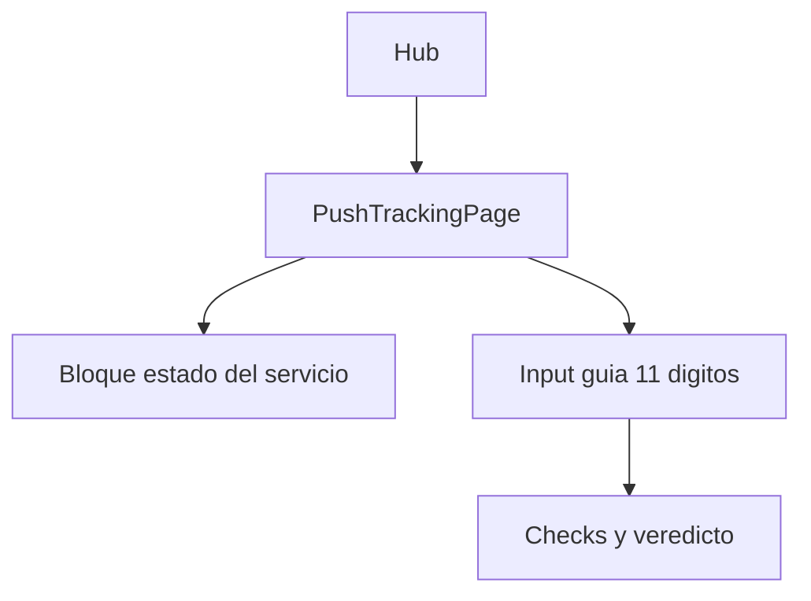

# Push Tracking — Front (`cm-toolbox-front`)

Diseño de la herramienta. **No implementada.** Companion: [back.md](./back.md) · [contrato-http.md](./contrato-http.md).

| Campo | Valor |
| --- | --- |
| Estado | Diseño |
| Ruta UI | `/push-tracking` (lazy, `AppAccessGuard`) |
| App hub | `appId` nuevo en access-ms (seed aparte; no reutilizar `diagnostico`) |
| Proxy | `/push-tracking-api/*` → `PUSH_TRACKING_API_UPSTREAM` |
| Referencia visual | `src/features/diagnostico/` (formulario + checks + veredicto) |

## 1. Objetivo

Una tarjeta del hub que permita:

1. Ver el estado del servicio (health) sin escribir una guía.
2. Diagnosticar una guía de 11 dígitos y leer checks del flujo MIO.
3. Reintentar solo si el contrato del MS lo expone de forma segura (ver [decisiones.md](./decisiones.md), ADR-PT-004).

## 2. Actores

| Actor | Qué ve |
| --- | --- |
| Sin permiso `push-tracking` | Tarjeta bloqueada o ausente (mismo modelo que el hub RBAC) |
| Con `view` | Health + diagnóstico de lectura |
| Con `retry` (si existe) | Botón de reintento de notificaciones **acotado a la guía**, nunca el POST operativo global del MS |

## 3. Pantallas



| Zona | Comportamiento |
| --- | --- |
| Estado del servicio | Al entrar, `GET` health. Badge healthy / degraded / unhealthy. Lista de dependencias. |
| Formulario | Un campo `guia`. Validar `/^\d{11}$/` en cliente antes de llamar. |
| Resultado | Veredicto + filas de check (cumple / no cumple / no aplica) al estilo `CheckRow`. |
| Vacío / error | Mismos patrones que diagnóstico: skeleton, mensaje de timeout, reintentar. |
| Sin endpoints | Si el proxy responde 404 del contrato de diagnóstico, mostrar “El servicio aún no expone diagnóstico”, no un veredicto inventado. |

## 4. Criterios de aceptación (cuando se construya)

| ID | Criterio |
| --- | --- |
| CA-PT-F01 | La ruta no renderiza datos si `AppAccessGuard` niega el `appId`. |
| CA-PT-F02 | Health se pide al montar y muestra cada check devuelto, sin filtrar claves desconocidas en silencio. |
| CA-PT-F03 | Guía que no son 11 dígitos no dispara el POST. |
| CA-PT-F04 | Timeout y `AbortSignal` cancelan la petición (30 s salvo que la API de diagnóstico documente otro). |
| CA-PT-F05 | El cliente usa solo paths relativos `/push-tracking-api/...`. |
| CA-PT-F06 | No hay botón que llame `estados-mio`, `notifica-cliente` ni recargas Redis. |

## 5. Archivos previstos

```text
src/features/push-tracking/
  push-tracking-page.tsx
  api/push-tracking-api.ts
  api/types.ts
  health-panel.tsx
  resultado-push-tracking.tsx
src/app/app.tsx                         ruta lazy
vite.config.ts                          proxy
nginx/default.conf.template             proxy prod
```

Registrar la app en access-ms (seed SQL) y una tarjeta de hub solo si el catálogo es dinámico: si el hub ya lista apps desde `/me/access`, basta el seed. No hardcodear una segunda tarjeta si el catálogo es la fuente.

## 6. Textos

| Situación | Copy |
| --- | --- |
| Título | Diagnóstico Push Tracking |
| Guía inválida | La guía debe tener 11 dígitos. |
| Servicio caído | No pudimos consultar el estado del servicio. |
| Sin contrato | Este ambiente no expone diagnóstico todavía. |
