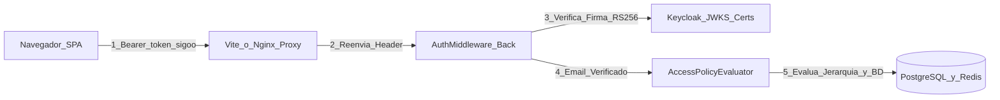

# Seguridad y Gobierno — RBAC (`cm-toolbox-access-ms` + `cm-toolbox-front`)

Complementa [seguridad-tokens-y-csp.md](../seguridad-tokens-y-csp.md) con los controles de seguridad específicos del sistema de roles, permisos y estado de aplicaciones.

---

## 1. Modelo de Confianza: Separación AuthN vs. AuthZ

| Capa                               | Responsabilidad                                                                  | Regla de Seguridad                                                                                                                                                                                                                                      |
| ---------------------------------- | -------------------------------------------------------------------------------- | ------------------------------------------------------------------------------------------------------------------------------------------------------------------------------------------------------------------------------------------------------- |
| **Keycloak (AuthN)**               | Emitir y firmar el JWT corporativo tras login con Google (`@coordinadora.com`).  | El backend nunca confía en un correo enviado por body o query param para saber quién ejecuta la petición: **solo** confía en el claim `email` / `preferred_username` del JWT cuya firma criptográfica fue validada contra el endpoint JWKS de Keycloak. |
| **`cm-toolbox-access-ms` (AuthZ)** | Determinar qué rol, qué aplicaciones y qué acciones tiene permitidas ese correo. | Es la única fuente de verdad. Aunque un usuario manipule el estado de React en el navegador para ver la pantalla `/admin`, cualquier petición a `/v1/admin/*` será rechazada con `403 Forbidden` en el servidor.                                        |
| **`cm-toolbox-front` (UX Guard)**  | Ocultar o deshabilitar vistas y botones según `EffectiveUserAccess`.             | No almacena roles ni permisos en `localStorage` para evitar manipulaciones triviales desde DevTools; los mantiene en memoria de React y los revalida con `/v1/me/access`.                                                                               |

---

## 2. Matriz de Autorización y Jerarquía de Roles

| Acción / Operación                                               | `admin` (`level: 100`)            | `sub_admin` (`level: 50`)              | `user` (`level: 10`)  |
| ---------------------------------------------------------------- | --------------------------------- | -------------------------------------- | --------------------- |
| Consultar su propio perfil (`GET /v1/me/access`)                 | Sí                                | Sí                                     | Sí                    |
| Entrar a una app en estado `active`                              | Sí (todas)                        | Sí (según rol/grants)                  | Sí (según rol/grants) |
| Entrar a una app en estado `maintenance`                         | **Sí (exclusivo para pruebas)**   | No                                     | No                    |
| Entrar a una app en estado `disabled`                            | No                                | No                                     | No                    |
| Cambiar estado de una app (`PATCH /v1/admin/apps/:id`)           | **Sí**                            | No (`403`)                             | No (`403`)            |
| Listar usuarios y catálogo admin (`GET /v1/admin/users`, `apps`) | Sí                                | Sí                                     | No (`403`)            |
| Crear / editar un usuario con rol `user`                         | Sí                                | **Sí**                                 | No (`403`)            |
| Crear / editar un usuario con rol `sub_admin` o `admin`          | **Sí**                            | No (`403 INSUFFICIENT_ROLE_HIERARCHY`) | No (`403`)            |
| Modificar o bloquear a un `Super-Admin`                          | No (`403 SUPER_ADMIN_PROTECTED`)  | No (`403`)                             | No (`403`)            |
| Modificar su propio rol o bloquearse a sí mismo                  | No (`400 SELF_LOCKOUT_PREVENTED`) | No (`400`)                             | No (`403`)            |
| Consultar bitácora de auditoría (`GET /v1/admin/audit`)          | **Sí**                            | No (`403`)                             | No (`403`)            |

---

## 3. Protección Anti-Lockout (Super-Admin Bootstrap)

Para evitar que un error humano en base de datos deje al portal sin administradores:

1. La variable de entorno `SUPER_ADMIN_EMAILS` (lista separada por comas) define los propietarios raíz del sistema.
2. En tiempo de ejecución, `AccessPolicyEvaluator` fuerza `isSuperAdmin = true` y `roleId = 'admin'` para cualquier correo en esa lista, incluso si la tabla `users` está vacía.
3. El endpoint `PUT /v1/admin/users/:email` bloquea con `403 SUPER_ADMIN_PROTECTED` cualquier intento de alterar un correo perteneciente a `SUPER_ADMIN_EMAILS` o marcado con `is_super_admin = true` en PostgreSQL.

---

## 4. Seguridad del Modo Desarrollo (`AUTH_MODE=disabled`)

- En desarrollo local (`NODE_ENV=development` o `test`), `AUTH_MODE=disabled` permite trabajar sin conectarse a Keycloak corporativo.
- **Guardia de arranque (Fail-Closed):** en `src/setup/Envs.ts`, si `NODE_ENV === 'production'` y `AUTH_MODE === 'disabled'`, el proceso lanza una excepción fatal antes de abrir el puerto HTTP.
- El header de simulación `x-dev-user-email` es ignorado por completo cuando `AUTH_MODE === 'keycloak'`.

---

## 5. Auditoría Inmutable y Privacidad

- La tabla `audit_logs` solo tiene operaciones `INSERT` y `SELECT` en `PgAccessRepository` (no existen métodos `UPDATE` ni `DELETE`).
- En los logs de aplicación (`console` / stdout) **nunca** se imprime el header `Authorization: Bearer ...`.
- Las consultas SQL utilizan exclusivamente parámetros preparados (`$1, $2, ...`) mediante el driver `pg`, eliminando cualquier vector de inyección SQL.
